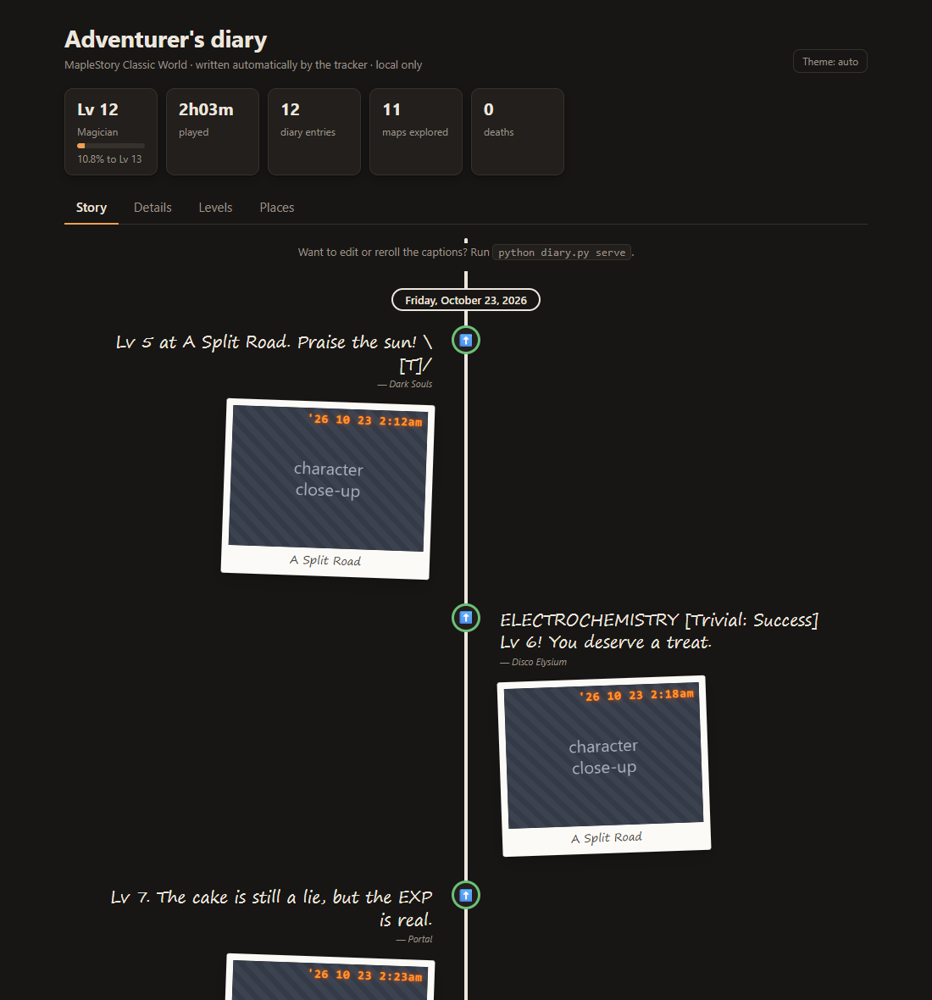
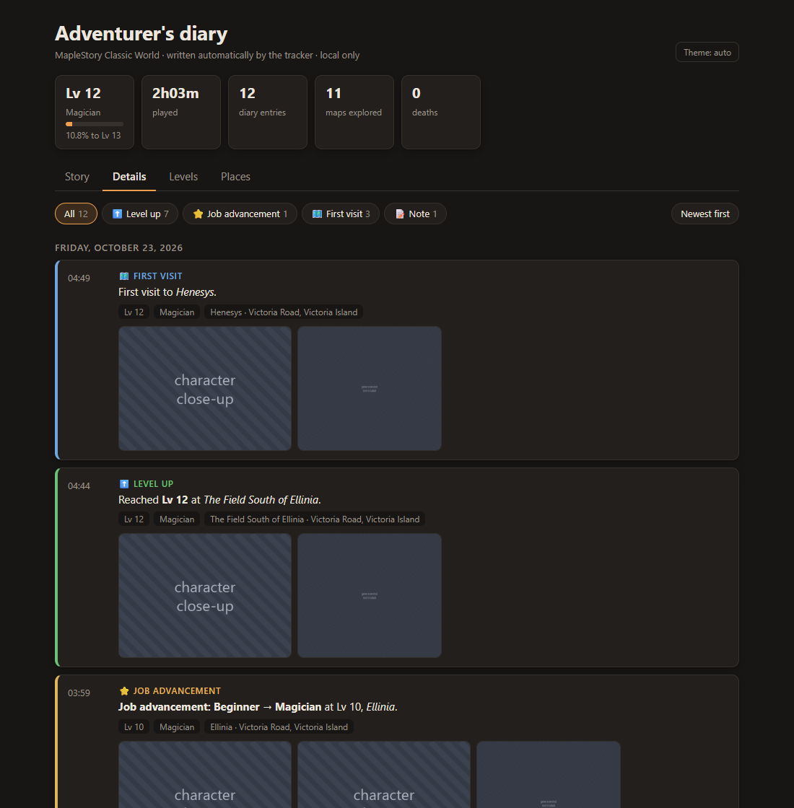
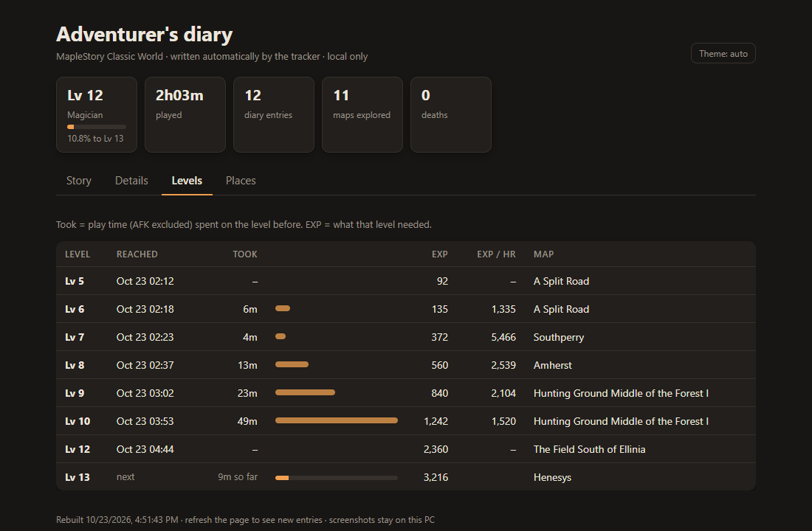
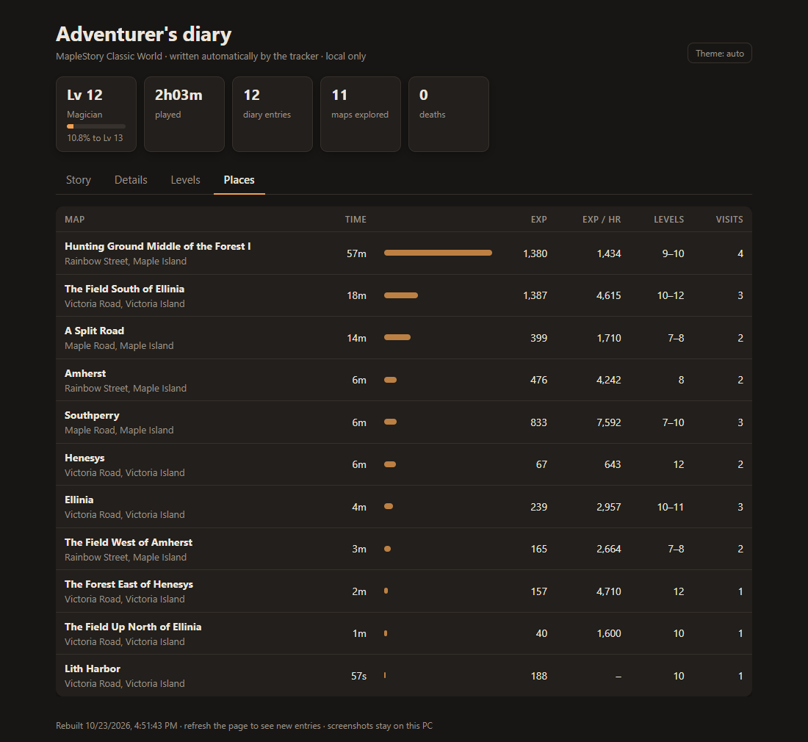
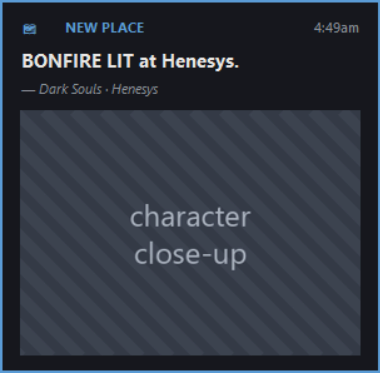
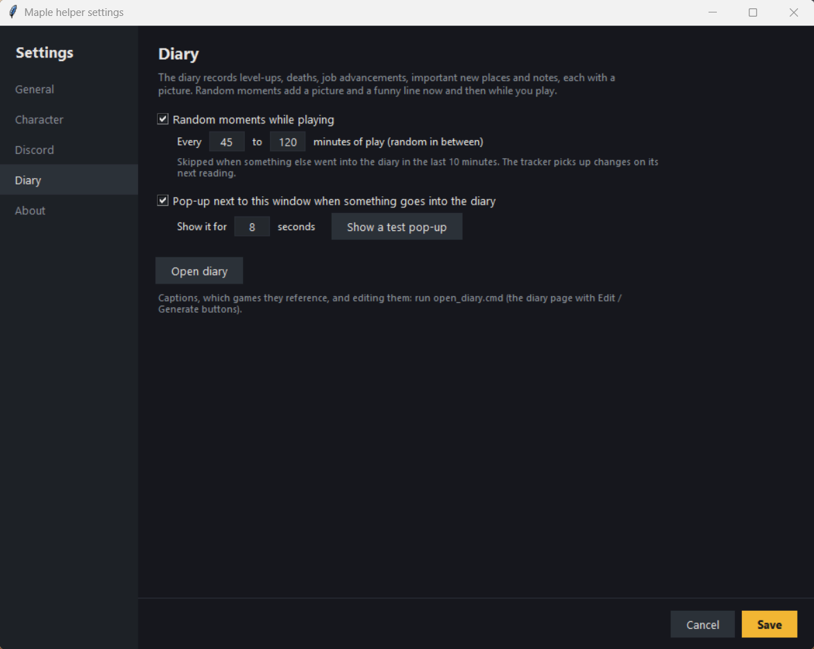

# Diary

> [!NOTE]
> Part of a personal project. See the [main README](../README.md) for what this is (and isn't).
> Screenshots use made-up data ("Adventurer"), and the striped boxes stand in for game screenshots,
> which are never published.

The diary is your character's scrapbook. The tracker writes it for you: every level-up, death, job
advancement and important new place gets an entry with a screenshot, a close-up of your character
and a one-line caption. Now and then, while you play, it also snaps a random moment.

## What goes in

| Entry | When |
|---|---|
| Level up | every new level |
| Death | when you lose EXP to dying (Lv 10+), with the killer when the map makes it clear |
| Job advancement | when the status bar shows a new job |
| New place | first visit to a town or landmark, or the first map of a new region |
| Moment | a random snapshot every 45 to 120 minutes of play (adjustable) |
| Note | anything you add yourself |

Each entry keeps the full game screenshot plus a close-up of your character, found by your name tag.

## Captions

Every entry gets a short, silly line. The caption dictionary (`captions.json`) has about 200 lines,
many of them nods to other games: Dark Souls, Disco Elysium, Portal, NieR: Automata, Fallout,
Baldur's Gate 3, Undertale, Hollow Knight, The Witcher, Warhammer 40k and more.

When running from source, `open_diary.cmd` opens the diary with **Edit** and **Generate** buttons
on each caption (write your own line or roll a new one) and a References panel to switch off
games you don't want captions to mention.

## Viewing it

The diary is a local web page (`diary.html` in your data folder) that rebuilds itself when entries
are added. Open it with **Open diary** in Settings > Diary, or by clicking a diary pop-up. It has
four tabs:

**Details**: every entry with its pictures, filterable by kind.

**Levels**: when you reached each level, how long it took and where.

**Places**: every map with time spent, EXP, EXP per hour and the levels you were there.

## Pop-ups

When something goes into the diary, a small card slides out next to the floating window with the
caption and the close-up. Click it to open the diary.

## Settings

Settings > Diary: turn random moments on or off and set how often they happen, and turn the
pop-ups on or off and set how long they stay. **Show a test pop-up** replays the latest entry.

## Privacy

The diary and its pictures stay on your PC (`%LOCALAPPDATA%\MapleClassicCompanion\diary.html`,
`screenshots/diary/`). Nothing is uploaded. Screenshots of the game are Nexon's imagery: keep them
for yourself.
