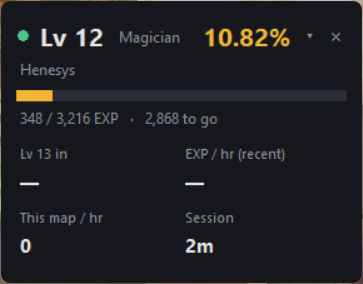
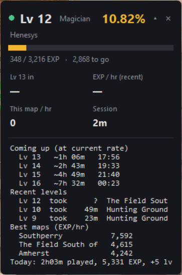
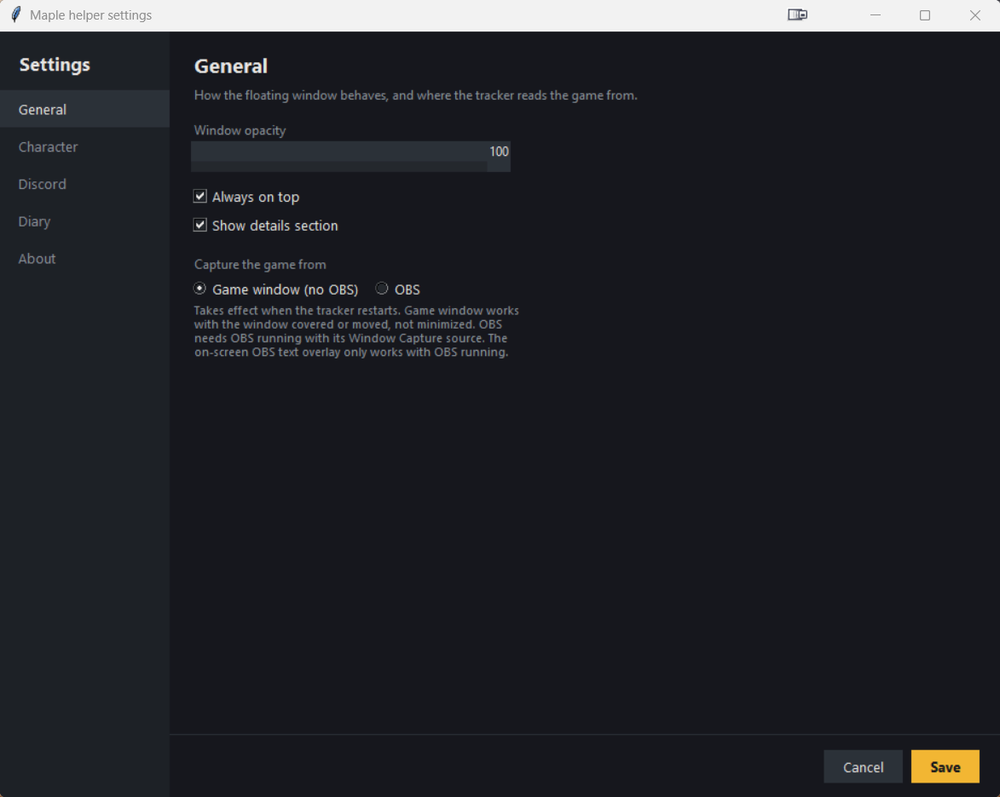
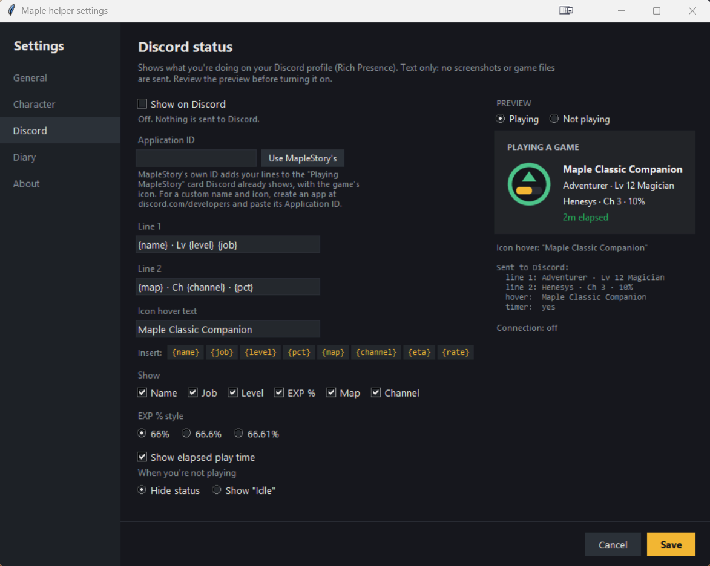
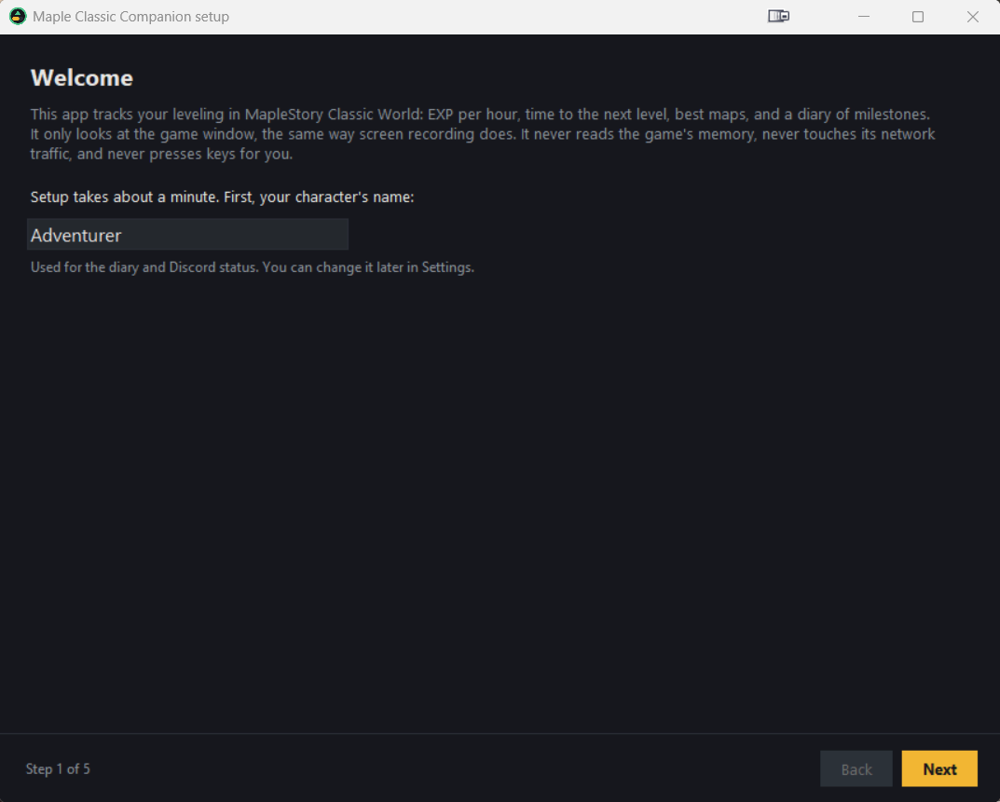

# Tracker

> [!NOTE]
> Part of a personal project. See the [main README](../README.md) for what this is (and isn't).
> Screenshots use made-up data ("Adventurer") and contain no game imagery.

The tracker is the part that watches your leveling. It runs quietly in the background, reads the
status bar and minimap from the game window, and turns that into EXP per hour, time to the next
level, best maps and a journal. A small floating window and a tray icon show the numbers.

  
  &nbsp;
  

## What it reads

Only what's already on your screen, from a copy of the game window's picture:

| On screen | What it gets |
|---|---|
| EXP bar (`1,234[56.78%]`) | current EXP and percent; EXP needed comes from the Classic EXP table |
| Level badge | your level |
| Status bar job name | your job (checked at start and when an advancement is possible) |
| Minimap title | the map you're on, matched against the 453 real Classic map names |

Digits are matched pixel by pixel against shapes learned from your own screen (first-run setup),
so they're exact. It learns digits it hasn't seen yet by itself, by checking which digits make the
EXP and percent agree. Map names use Tesseract OCR.

## What it works out

- **EXP per hour** (recent and per map) and **time to the next level**, with a clock time.
- **Sessions**: a session starts when the EXP bar is on screen and EXP moves. Time spent AFK isn't
  counted. It closes after 10 minutes without the game on screen or 30 minutes AFK.
- **Level-ups**, with how long each level took in actual play time.
- **Deaths** (Lv 10+, where dying costs EXP), with the EXP lost. If the map has only one kind of
  monster, or it's a known boss map, it also says who did it.
- **Best maps** by EXP per hour, and a projection for your next few levels.
- **Job advancements** and the maps you visit.

It reads faster when something interesting is close (like the last stretch before a level-up) and
slower when you're idle.

## The floating window

- Drag to move, double-click to show or hide details, right-click for the menu.
- The colored dot shows the tracker's state: green playing, amber idle, grey stopped.
- The tray icon (near the clock) shows or hides the window and has the same menu.

## Settings

Right-click the window, then **Settings…**. Pages: General (opacity, always on top, details),
Character (name, job, channel), Discord, Diary, About.

### Discord status (optional, off by default)

Shows your level, job, map and EXP % on your Discord profile, through the Discord app on your PC.
Text only, nothing else is sent. Every field can be hidden, and the preview shows exactly what
Discord will get.

## First-run setup

The first time it starts, a short setup learns from your own screen: open the game in a window with
the minimap visible, press **Capture**, then type what your EXP bar and level show. Nothing from the
game ships with the app; these small reference pieces stay on your PC.
Run it again any time from the right-click menu (**Run setup…**).

## Files it writes

All in your data folder (`%LOCALAPPDATA%\MapleClassicCompanion`, or the project folder when run
from source):

| File | What's in it |
|---|---|
| `journal.md` | readable log: sessions, level-ups, map changes, deaths |
| `digest.json` | summary: level, ETA, EXP/hr, last 7 days, best maps, projection |
| `status.json` | live snapshot the floating window reads |
| `history/levels.csv`, `sessions.csv`, `map_stats.json` | long-term stats |
| `sessions/<time>/` | per-session readings; saved frames are deleted after 14 days |
| `tracker_live.log` | one line per minute plus events |
